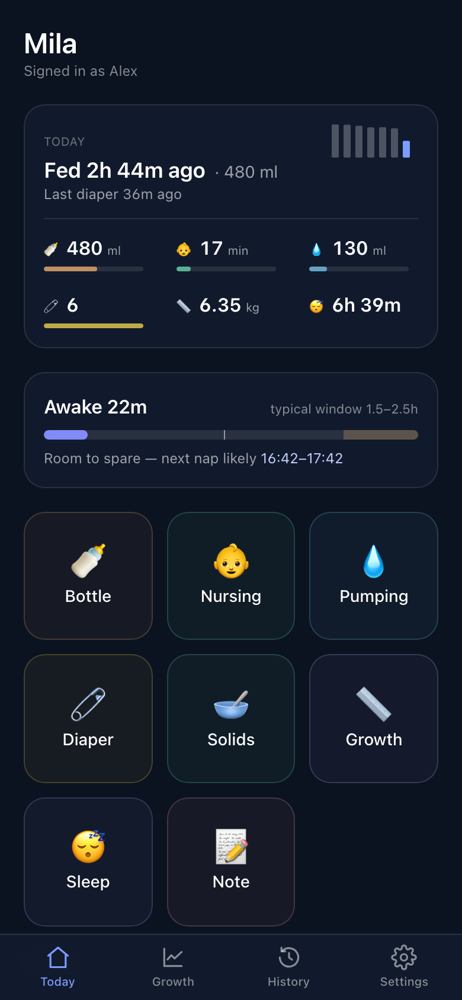
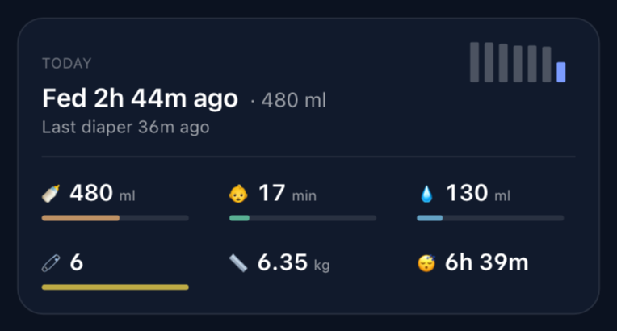
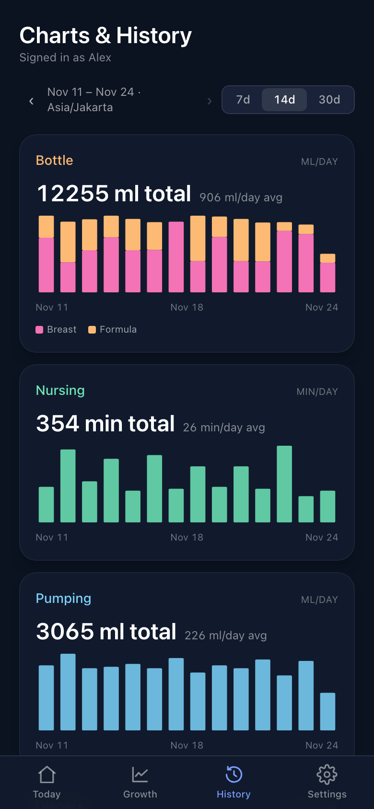
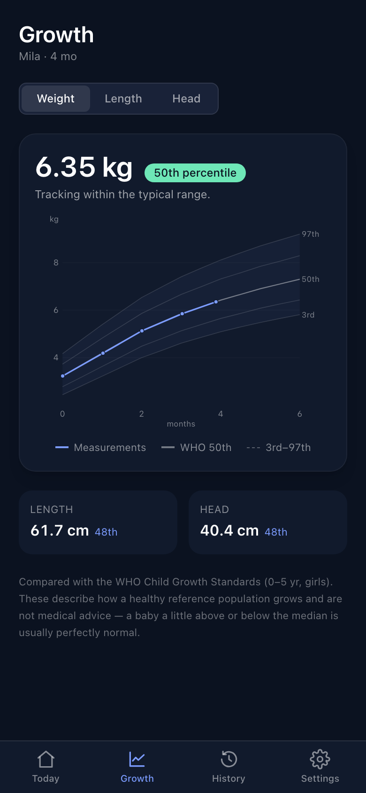
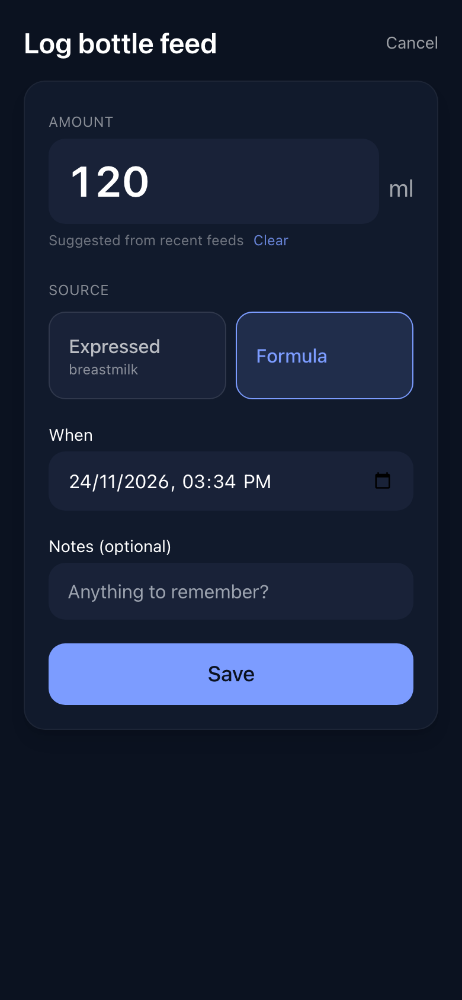
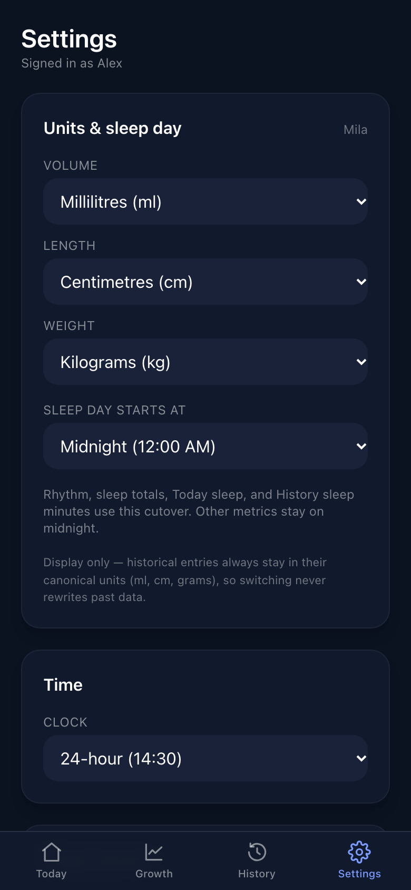

<p align="center">
  
</p>

# Evernest

A shared baby tracker for households: feedings, sleep, diapers, and growth, with charts.

<p align="center">
  
</p>

<p align="center"><em>One glance at the day. Tap a tile to log.</em></p>

## Why

In the newborn weeks, every caregiver asks the same question: when did the baby
last eat? Evernest gives the whole household one log on their phones. Anyone can
record a feed, a diaper, or a nap in a tap, and everyone else sees it right
away. You host it yourself, so your baby's data stays on your own server.

## Get it

There is no app store build and no public hosted instance. Evernest runs on a
server you control (a home server or a small VPS) and you reach it from your
phone over [Tailscale](https://tailscale.com).

1. Set up the server. Follow [docs/self-host.md](docs/self-host.md).
2. Open your Evernest address in the phone's browser and create an account.
3. Install it to the home screen. On iOS, tap **Share → Add to Home Screen** in
   Safari. On Android, tap **Install app** in Chrome.
4. Invite the other caregivers from **Settings** with a link.

## Features

### Today

See when the baby last ate or had a diaper change, today's totals, and the
latest entries. Log a bottle, nursing, pumping, diaper, solids, growth, sleep, or a note
in one tap.

<p align="center">
  
</p>

### Charts and history

Daily trends for bottle, nursing, pumping, diapers, and sleep over 7, 14, or 30
days, with every entry listed day by day underneath.

<p align="center">
  
</p>

### Growth

Weight, length, and head circumference plotted against the WHO Child Growth
Standards percentiles for your baby's age and sex.

<p align="center">
  
</p>

### Works offline

Quick forms for every kind of entry. With no signal, entries save on the phone
and sync when you are back online.

<p align="center">
  
</p>

### Household

Invite co-caregivers with a link, track more than one baby, and pick display
units (ml or oz, cm or in, kg or lb).

<p align="center">
  
</p>

### Switching from BabyPlus

Bring your history with you. Export from BabyPlus and import the file; see
[docs/import-babyplus.md](docs/import-babyplus.md).

## System requirements

- **Phone:** iOS Safari or Android Chrome. Any modern desktop browser works too.
- **Server:** an x86-64 Linux host with Docker and Docker Compose.
- **Network:** a free Tailscale account. Tailscale supplies the HTTPS address
  the app needs to install and keep you signed in.

## Privacy and data

- **What is stored:** your account, household, babies, and every entry, in a
  Postgres database on your server. The phone keeps a queue of unsynced entries
  until the server confirms them.
- **What leaves your server:** nothing, unless you turn on these optional
  settings:
  - Off-site backups. Nightly database dumps are kept on the server (7 daily,
    4 weekly, 6 monthly). If you set `RCLONE_REMOTE`, a copy is encrypted with
    `rclone crypt` and uploaded to your Google Drive.
  - A health-check ping after each backup, if you set `HEALTHCHECK_URL`.
- **Who can reach it:** only devices on your tailnet. The database has no open
  port.
- **Export and delete:** you can delete single entries in the app. There is no
  in-app export or account deletion yet. The full data is in your database:
  `make db-backup` writes a Postgres dump.
- **Update and remove:** see [Update](docs/self-host.md#update) and
  [Remove](docs/self-host.md#remove) in the hosting guide.

## Support

Report bugs and ask questions in
[GitHub issues](https://github.com/VictorArsjad/evernest/issues).

## Contributing

**Stack:** Go API (`chi`, `pgx`) with Postgres 16, and a Vite + React +
TypeScript PWA. In production the API binary serves the web app from the same
origin.

**Prerequisites:** Docker, Go 1.26, Node 22 (see `.nvmrc`), and the
[golang-migrate](https://github.com/golang-migrate/migrate) CLI.

```bash
make env-init      # copy .env.example to .env
make db            # start Postgres in Docker
make migrate-up    # apply schema migrations
make web-install   # install web dependencies
```

Then, in two terminals:

```bash
make api-run       # API on :8080
make web-dev       # web on :5173, proxies /v1 to the API
```

Open <http://localhost:5173>, create an account, set up a household and a baby,
and log a bottle feed.

Before you open a PR, run the same checks as CI:

```bash
make lint && make api-test && make web-build
```

Run `make help` for every target (migrations, imports, backups, images).

```text
apps/
  api/     Go backend, migrations, and the BabyPlus importer
  web/     Vite + React PWA
infra/     Docker Compose files and Dockerfiles
docs/      API contract, schema, deploy runbook, screenshots
```

Further reading:

- [AGENTS.md](AGENTS.md): architecture, invariants, and where to start for common changes
- [docs/schema.md](docs/schema.md): database schema
- [docs/api.openapi.yaml](docs/api.openapi.yaml): HTTP contract

## License

[MIT](LICENSE)
