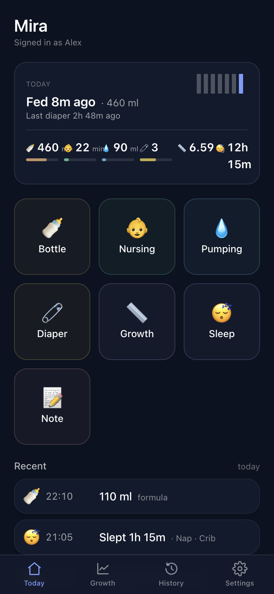
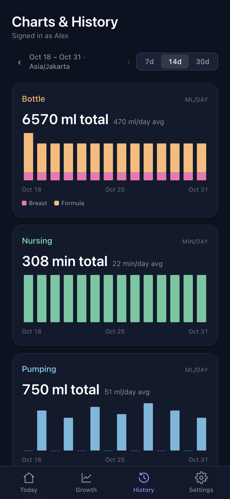
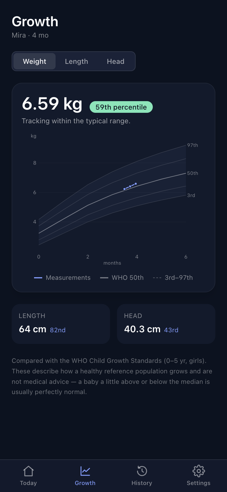
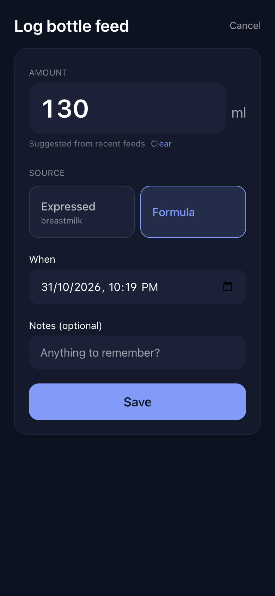
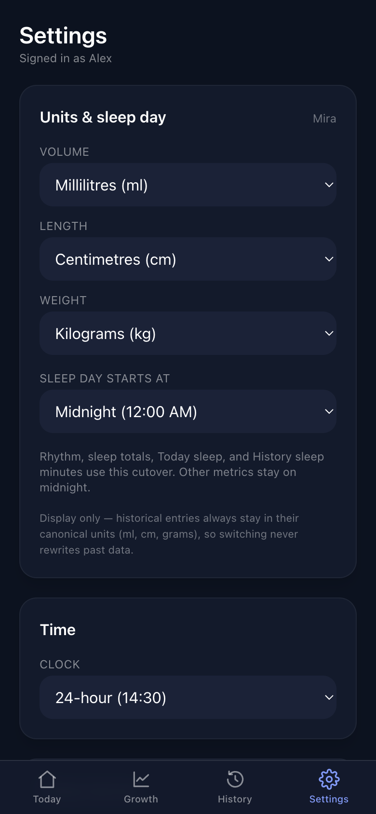

# Evernest

A baby tracker for households — feedings, sleep, diapers, growth, and charts,
shared across caregivers.

<p align="center">
  
</p>

<p align="center"><em>One glance at the day. Tap a tile to log.</em></p>

## Features

### Today

See when baby last ate or had a diaper change, today's totals, and a recent
activity list. Log bottle, nursing, pumping, diaper, growth, sleep, or a note
in one tap.

### Charts & History

<p align="center">
  
</p>

Daily trends for bottle, nursing, pumping, diapers, and sleep over 7 / 14 / 30
days, with a day-by-day history of every entry underneath.

### Growth

<p align="center">
  
</p>

Weight, length, and head circumference plotted against WHO Child Growth
Standards percentiles for your baby's age and sex.

### Log anything

<p align="center">
  
</p>

Quick forms for every event kind. Works offline — entries sync when you're
back online. Install as a PWA on iOS or Android.

### Household & settings

<p align="center">
  
</p>

Invite co-caregivers with a link, track more than one baby, and pick display
units (ml/oz, cm/in, kg/lb).

## Quick start

```bash
make env-init      # copy .env.example -> .env
make db            # start postgres in docker
make migrate-up    # apply schema migrations
make web-install   # install web dependencies
```

Two terminals:

```bash
make api-run       # API on :8080
make web-dev       # Vite on :5173 (proxies /v1 to the API)
```

Open <http://localhost:5173>, create an account, set up your household + baby,
and log a bottle feed.

```bash
make lint && make api-test && make web-build   # smoke before a PR
```

| Task | Command |
| --- | --- |
| Start db | `make db` |
| Run API | `make api-run` |
| Run web | `make web-dev` |
| Lint / test | `make lint` / `make test` |
| New migration | `make migrate-new name=add_xyz` |
| Import BabyPlus | `make import-babyplus FILE=… HOUSEHOLD=…` |

Run `make help` for the full target list.

## Repo layout

```
apps/
  api/      Go backend
  web/      Vite + React + TS PWA
infra/     docker compose + Dockerfiles
docs/      OpenAPI, schema, deploy, screenshots
```

## See also

- [AGENTS.md](AGENTS.md) — contributor briefing
- [docs/deploy.md](docs/deploy.md) — deploy + backups
- [docs/schema.md](docs/schema.md) — database schema
- [docs/api.openapi.yaml](docs/api.openapi.yaml) — HTTP contract
- [docs/import-babyplus.md](docs/import-babyplus.md) — BabyPlus import
- [apps/web/public/icons/README.md](apps/web/public/icons/README.md) — PWA icons
